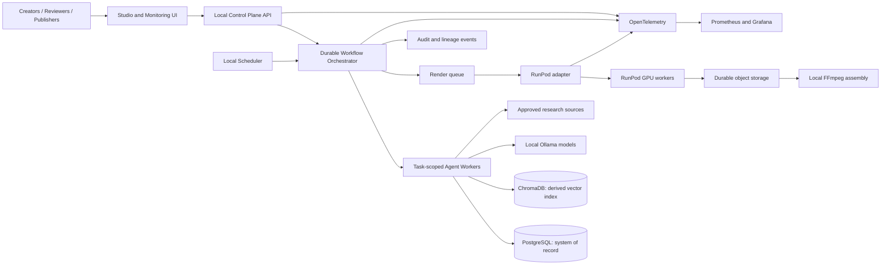
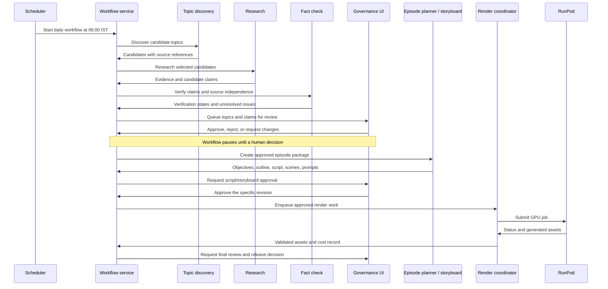
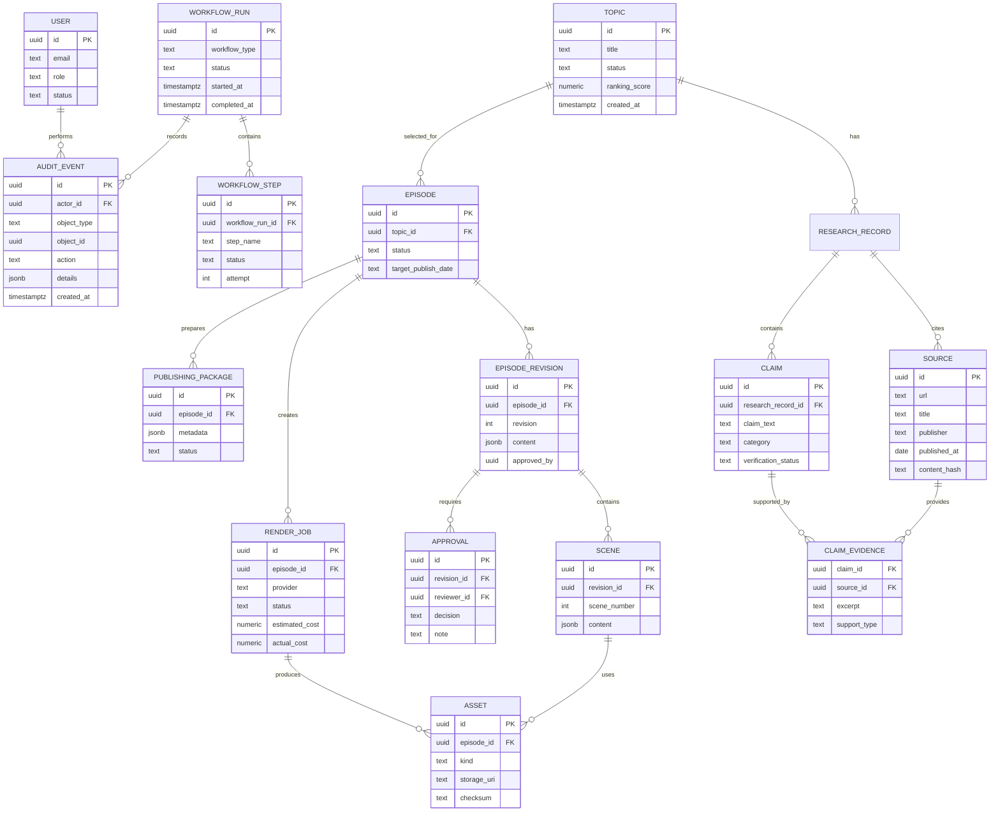

# Universal Video Maker — System Architecture

**Status:** Approved architecture baseline  
**Implementation status:** Core Platform, Database Layer, Topic Discovery,
Research, Fact Check, RAG, Episode Planner, Storyboard, RunPod Integration,
Rendering, Publishing, Analytics, and Governance/Monitoring UI previews have
implementation foundations and tests. Tavily and Ollama adapters now support
excerpt-based research, local embeddings, and evidence-grounded plan drafts.
Keycloak token verification and MinIO object-storage adapters are also
implemented. These components are not wired into an authenticated
end-to-end topic-to-video workflow; the governance UI, remote render worker,
and live provider calls have not been validated.  
**Audience:** Product, engineering, editorial, operations, and governance teams.

## 1. Mission and product scope

Universal Video Maker is designed for user-submitted topics from any subject.
Each project should select its target audience, style, safety policy, and
output profile. Factual content must be grounded in reviewed evidence, and
human approval is required before release. Project profiles are an
architectural requirement, not yet a persisted or configurable feature.

The current planning services still enforce an initial three-minute episode
and three 30–60-second Shorts profile. Topic intake is domain-neutral, but the
web UI remains a browser-session preview and the services are not connected
to an end-to-end generation workflow. Tavily/Ollama provider adapters exist;
topic safety classification, media generation, external publishing, and
platform analytics are not live integrations.

Creative direction and reusable original assets are selected per project.
Do not imitate a named studio's distinctive style or use its characters,
assets, or branding.

### Publishing cadence

- Two three-minute episodes per week, scheduled for Tuesday and Friday.
- Three vertical Shorts per episode, each 30–60 seconds.
- Daily topic discovery and research workflow at 6:00 AM India Standard Time.
- Episode production is triggered only for publishing days and passes editorial
  approval gates.

## 2. Architecture principles

1. **Laptop is the control plane.** Scheduling, workflow state, agent
   coordination, approvals, metadata, and monitoring remain local.
2. **RunPod is the rendering plane.** Remote GPU capacity is used only for
   workloads that benefit from it; it does not own governance or scheduling.
3. **Evidence before generation.** Factual scripts are drafted from retrieved,
   reviewed evidence, not directly from model memory.
4. **Human approval before release.** Humans review claims, scripts, renders,
   and publishing packages. The MVP does not publish autonomously.
5. **PostgreSQL is authoritative.** Vector indexes and dashboards are
   projections of durable application records.
6. **Provider independence.** Model and media vendor details are isolated
   behind typed interfaces and adapters.
7. **Traceability by default.** A released video can be traced to approved
   script revisions, claims, sources, assets, provider versions, and costs.
8. **Modular delivery.** Start with a small number of deployable processes
   and explicit module boundaries; do not create a microservice fleet before
   operational need is demonstrated.

## 3. High-level architecture



### Planes and responsibilities

| Plane | Responsibilities |
|---|---|
| Control plane (laptop) | API, UI, scheduling, workflow state, agents, approvals, metadata, observability |
| Rendering plane (RunPod) | Isolated GPU image/video/lip-sync tasks and output transfer |
| Persistence plane | PostgreSQL records, ChromaDB embeddings, durable object storage |
| Editorial plane | Human review, fact decisions, revision approval, release authorization |

The local scheduler depends on the laptop being powered on, awake, connected,
and able to run the required containers at 6:00 AM IST. Sleep, restart, and
network failures may delay scheduled work. This is an explicit operating
constraint, not an assumed always-on guarantee. If availability requirements
increase, move the control plane to an always-on host without changing the
logical separation from the GPU rendering plane.

## 4. Detailed system components

| Component | Responsibility |
|---|---|
| Governance UI | Topic/research queues, claim review, approvals, calendar, lineage, reports |
| Control Plane API | Authentication boundary, validation, commands, queries, health |
| Scheduler | Daily 6:00 AM IST workflow and Tuesday/Friday episode triggers |
| Workflow service | Durable state, retries, timeouts, cancellation, approval pauses |
| Agent workers | Discovery, research, claim extraction, ranking, planning, metadata |
| Knowledge service | Source ingestion, text extraction, chunking, retrieval, vector index maintenance |
| Provider adapters | Model, TTS, image, video, and lip-sync vendor integrations |
| RunPod adapter | Pod lifecycle, job submission/status, results, retries, cost records |
| Media assembler | Input checks, episode/Shorts assembly, captions, audio, export |
| Observability stack | Structured logs, metrics, traces, health, and alerts |

Use a durable workflow engine capable of pausing for human approval and
recovering after process restarts. Confirm Windows/WSL2 compatibility before
choosing the engine. A database-backed state machine is acceptable for an MVP
if state and retries survive restarts.

## 5. Agent workflow and boundaries

Agents are task-specific workers with typed inputs and outputs. They do not
have unrestricted access to tools, credentials, or publishing actions. Each
task records the model/provider/version, prompt or template version, workflow
correlation ID, and output revision.

### Daily research workflow



### Agent responsibilities

1. **Topic Discovery:** propose topics from approved source catalogs, current
   events, historical milestones, practical questions, and other subject areas.
2. **Research:** collect source metadata, relevant passages, timelines,
   people, relevant data, and candidate factual claims.
3. **Fact Check:** classify evidence, identify contradictory claims, check
   source independence, and flag unsupported or sensitive statements.
4. **Topic Ranking:** score subject relevance, story/visual potential, search
   interest, audience suitability, novelty, and timeliness.
5. **Episode Planner:** define learning objectives, story arc, three-minute
   structure, and three Shorts concepts.
6. **Storyboard:** produce schema-validated scene breakdowns, action, camera,
   transitions, and visual descriptions.
7. **Prompt Engineering:** produce versioned character/image/video/animation
   prompts linked to the approved storyboard.
8. **Render Coordinator:** validate work, submit image/video/lip-sync jobs,
   monitor status, retry eligible failures, and collect assets.
9. **Publishing Package:** produce metadata, titles, descriptions, tags,
   hashtags, thumbnail concepts, and later analytics inputs.
10. **Governance:** enforce review states, record approvals, track sources,
    lineage, audit events, and estimated/actual costs.

## 6. Governance, safety, and editorial controls

### Roles

- **Admin:** manage users, configuration, and all governance actions.
- **Editor:** manage topics and episode revisions.
- **Fact Reviewer:** review evidence and claim classifications.
- **Publisher:** authorize release and publishing metadata.
- **Viewer:** read permitted queues, episodes, and calendar views.

Keycloak is the selected self-hosted OpenID Connect identity provider. A local
development realm is defined in `identity/keycloak/universal-video-maker-realm.json`
and can be started with Docker Compose. The API verifies RS256 access-token
signature, issuer, audience, expiry, and realm roles at `/api/v1/auth/me`.
Unknown role names are ignored and therefore grant no application permissions.
This endpoint verifies identity only: domain operations are not yet exposed
through authenticated routes, external Keycloak subjects are not mapped to
internal `User` rows, and the governance UI does not have a login flow.

The Compose configuration uses Keycloak development mode and a local embedded
database; it is not a production deployment. Production requires a supported
persistent Keycloak database, HTTPS, secure bootstrap/admin practices, and
role/user lifecycle management. Role policy checks must remain at the
application use-case boundary, not only in UI code.

### Approval gates

Require explicit human decisions before:

1. Promoting research into approved factual evidence.
2. Locking an episode script/storyboard revision.
3. Starting billable rendering.
4. Releasing or publishing completed content.

Every approval references the exact revision, actor, timestamp, decision, and
optional explanation. A changed revision invalidates earlier approvals for
that revision.

### Claim and source governance

Every factual claim stores evidence references, supporting passages, retrieval
date, and verification state. Two URLs that reproduce the same press release
are not independent sources. Track source lineage and publisher so independence
can be reviewed.

Use claim categories such as `verified`, `historical_record`,
`scientific_theory`, `opinion`, `myth_or_legend`, and `rejected`, adapting
classification to the subject. Distinguish documented facts from
interpretation and opinion. Unsupported claims must not be presented as
established fact.

Fact verification is not a general content-safety system. Before enabling
automated generation for arbitrary topics, add a project policy profile and
route sensitive or high-impact subjects (including medical, legal, financial,
civic, and self-harm content) to appropriately qualified human review. The
current application has no automated topic-risk classifier; evidence checks
must not be treated as a substitute for safety review.

### Audit and release manifest

Audit events are append-only and include actor, timestamp, action,
object/revision, reason, and relevant before/after state. Each released video
has a manifest containing approved script revision, claim IDs, source
snapshots/hashes, assets, provider/model versions, and final output checksums.

## 7. Monitoring and operations architecture

Instrument the API, workflow steps, agents, and RunPod adapter with
OpenTelemetry. Export metrics to Prometheus and visualize with Grafana. Use
structured JSON logging and correlation IDs. Do not log secrets, API keys,
full credentials, or unnecessary personal data.

### Operational signals

- Workflow runs by status, duration, age, and failure reason.
- Agent task duration, provider/model, retries, and output validation failures.
- Queue depth and time waiting for editorial review.
- RunPod job duration, GPU type, estimated/actual cost, and failure rate.
- Object storage usage and asset-transfer failures.
- Assembly duration and media validation errors.
- Scheduled workflow lateness relative to 06:00 IST.
- Backup age, restore-test result, and remaining local disk capacity.

### Alerts

Alert on failed/overdue workflows, repeated provider errors, jobs exceeding
timeouts, budget limits, low disk space, failed backups, and missed scheduled
runs. Dashboards must distinguish a failed job's cost from completed output
cost.

## 8. Data architecture and ER model

### Storage choices

- **PostgreSQL:** topics, sources, research, claims, approvals, episodes,
  revisions, assets, RunPod jobs, publishing metadata, users, workflows, and
  audit logs.
- **ChromaDB:** embeddings and searchable chunks for reviewed source passages,
  factual claims, and approved content.
- **Object storage:** source snapshots, generated media, renders, and exports.
  Local disk is suitable for development; durable production storage should be
  S3-compatible.

PostgreSQL is the system of record. ChromaDB is a rebuildable index linked by
stable IDs to source, claim, and revision records. Database migrations are the
authoritative schema change mechanism.

### Persistence implementation

The initial persistence module uses SQLAlchemy 2 models, synchronous sessions,
typed repositories, and Alembic migrations. It includes the topic, source,
research, claim/evidence, episode/revision, scene, asset, render job,
approval, workflow, audit, publishing package, and user records. PostgreSQL
uses JSONB for structured records; SQLite is used for isolated repository
tests. ChromaDB is accessed through an adapter that accepts externally
generated embeddings, with a persistent local collection configured by
`UVM_CHROMA_PERSIST_DIRECTORY` and `UVM_CHROMA_COLLECTION`.

Topic discovery provenance is stored on topic records: summary, source
references, ranking inputs/model, and a deterministic deduplication key.
Research records link to source metadata and a caller-managed snapshot URI;
source content hashes are verified against captured UTF-8 bytes. The current
source schema allows one immutable content hash per canonical URL, so changed
content at an existing URL is rejected pending versioned source snapshots.

Apply schema changes with `python -m alembic upgrade head` after setting
`UVM_DATABASE_URL`. Create custom-format PostgreSQL dumps with
`scripts/backup-postgres.ps1`; configure PostgreSQL password-file
authentication and copy backups off-device. Restore drills and object-storage
backup policy remain operational responsibilities.



## 9. Domain model

- **Topic:** title, category, subject relevance, audience suitability, novelty,
  visual potential, evidence strength, ranking, and lifecycle status.
- **Source:** canonical URL, publisher, publication/retrieval dates, content
  hash, source type, and reliability notes.
- **Claim:** exact statement, category, evidence links, support/contradiction
  state, reviewer, and review history.
- **ResearchRecord:** topic, source set, extracted facts, open questions, and
  revision.
- **Episode:** topic, audience, language, duration target, production status,
  and scheduled date.
- **EpisodeRevision:** learning objectives, outline, script, scenes, prompts,
  claim references, and source references.
- **Scene:** narration, character actions, camera direction, visual prompt,
  duration, and required assets.
- **Character:** original design profile, approved reference assets,
  expressions, voice profile, and version.
- **Asset:** media type, storage location, checksum, provider, prompt/revision,
  provenance/license, and validation state.
- **RenderJob:** provider, workload, parameters, remote ID, retries, timings,
  estimated/actual cost, and output assets.
- **Approval:** reviewer, decision, comments, exact revision ID, and time.
- **WorkflowRun:** trigger, status, step history, retry policy, and correlation
  ID.

## 10. API contracts

Version HTTP endpoints under `/api/v1`. Mutations require authentication and
role checks. Use typed schemas, pagination, consistent errors, idempotency
keys for job creation, and workflow/job IDs for long-running requests. Clients
may poll status or consume server-sent events.

| Endpoint | Purpose |
|---|---|
| `GET /topics?status=&from=&to=` | Browse/filter topic queue |
| `POST /topics` | Create or import a topic |
| `POST /topics/{id}/research` | Start research workflow |
| `GET /topics/{id}/claims` | Read claims, evidence, and verification |
| `POST /claims/{id}/review` | Record a reviewer decision |
| `POST /episodes` | Create episode from an approved topic |
| `GET /episodes/{id}` | Read episode and lineage |
| `POST /episodes/{id}/approve` | Approve a specific revision and stage |
| `POST /episodes/{id}/render` | Enqueue approved render work |
| `GET /jobs/{id}` | Inspect local/remote job state |
| `POST /jobs/{id}/retry` | Retry an eligible failed job |
| `GET /calendar` | Read scheduled/completed publishing dates |
| `GET /audit-events?object_id=` | Review traceable changes |
| `GET /health/live` | Process liveness |
| `GET /health/ready` | Readiness for traffic |

Long-running work must not be represented as a synchronous success response.
Return a run/job identifier and report progress/failure explicitly.

## 11. RAG and evidence pipeline

```text
Approved source discovery
  -> fetch source and preserve metadata/content hash
  -> extract text and chunk with source offsets
  -> embed chunks and store in ChromaDB
  -> extract candidate claims with source/chunk references
  -> verify support across independent sources
  -> human review for disputed or sensitive claims
  -> retrieve approved evidence for episode drafting
  -> validate factual script statements against claim IDs
  -> preserve citations and revision lineage
```

- Draft factual content only from retrieved, approved evidence.
- Record embedding model/version and chunking parameters to enable rebuilds.
- Filter retrieval by source date/type, topic, and approval state.
- A retrieval miss blocks factual assertions or routes the topic back to
  research; never fabricate a success-shaped answer.
- Keep unapproved research out of the approved-content retrieval collection.

## 12. Local model and provider strategy

Ollama is the preferred local inference runtime. Candidate models include
Qwen 2.5 7B and Llama 3.2; candidate embeddings include Nomic Embed. Benchmark
quality, latency, and memory on the actual laptop before locking model choices.
Local models are suitable for routine work only when evaluation demonstrates
adequate quality.

Provider interfaces:

| Capability | Interface | Initial candidates |
|---|---|---|
| Image generation | `IImageProvider` | Flux Dev, Flux Kontext, SDXL |
| Video generation | `IVideoProvider` | Wan 2.2, Hunyuan Video, LTX-2.5 via ComfyUI (selected) |
| Speech | `ITTSProvider` | Piper local default, Coqui, Azure Speech |
| Lip sync | `ILipSyncProvider` | MuseTalk, LatentSync |

Provider implementations must declare supported capabilities, validate
parameters, return typed results, and surface provider errors. Future providers
must be pluggable without leaking vendor-specific SDK types into domain logic.

## 13. RunPod rendering architecture

The local RunPod adapter owns credentials and provider dispatch. GPU workers
accept scoped job inputs, fetch permitted assets, perform the render, write
outputs to durable storage, and return status. They do not approve factual
content or publish.

```text
Validate request
  -> estimate cost and enforce budget/approval
  -> provision or resume pod
  -> submit idempotent job
  -> monitor status and timeouts
  -> verify/download outputs
  -> record usage, lineage, and costs
  -> pause or terminate pod under configured policy
```

Support launch, resume, pause, terminate, submission, monitoring, bounded
retry, result retrieval, caching, runtime tracking, and cost tracking. Select
GPU type per workload rather than assuming one GPU is universally optimal.
Cache by content hash of provider/model version, prompt, inputs, and render
parameters. Enforce per-job/episode/month budgets; exceeding a threshold pauses
work and requires approval.

### RunPod Serverless adapter implemented

The initial adapter targets configured Serverless endpoints rather than
long-lived pods. It authenticates with a secret setting, submits the local
render-job UUID for worker-side deduplication, records remote status/runtime/
cost, supports status and cancellation calls, and allows bounded manual retry
only after a terminal failure. Render submission is gated on human approval
of the exact storyboard revision and configured USD per-attempt/monthly spend
caps. HTTP transport is injectable; tests never call RunPod or incur charges.

Persistent pod lifecycle, automatic polling/scheduling, output transfer,
provider-specific GPU selection, caching, episode-level budgeting, and
operational endpoint provisioning remain to be integrated. Configure
`UVM_RUNPOD_API_KEY` as a secret and keep the endpoint ID/runtime policy in
deployment configuration; `.env.example` contains no credential value. Commit
the local queued render job before dispatching the billable external request;
the service leaves transaction ownership to its caller.

### Selected ComfyUI video worker

The selected media path is LTX-2.5 through ComfyUI on a Runpod Serverless
worker. The official [LTX ComfyUI guide](https://docs.ltx.video/open-source-model/integration-tools/comfy-ui)
recommends a CUDA GPU with at least 32 GB VRAM and 100 GB free disk; the
official model repository describes a roughly 66 GiB model download and
requires accepting its community license and gated model terms. Do not embed
Hugging Face credentials or model weights in this repository or container
image. Provision model access and a persistent model cache through Runpod
secrets/volumes after accepting the applicable terms.

The [Runpod ComfyUI worker](https://github.com/runpod-workers/worker-comfyui)
accepts exported API-format workflow graphs. Its documented object-store
response examples cover image outputs; video output upload, LTX node/model
provisioning, MinIO compatibility, and the final multi-scene assembly contract
must be verified in a custom worker before enabling dispatch. No LTX weights
have been downloaded, no paid jobs have been submitted, and the remote worker
is not yet implemented or validated.

### MinIO object storage adapter

`MinioObjectStore` uses the S3-compatible API for checksum-tagged object
uploads/downloads and returns `s3://` URIs. `MinioArtifactInspector` downloads
the selected object to a temporary local file, validates its actual media
properties with the existing `ffprobe` inspector, and removes the temporary
copy. The bucket must be created separately; the adapter does not provision
bucket policies or credentials.

Loopback HTTP is allowed for local development; remote endpoints must use
HTTPS. A Runpod worker cannot reach a MinIO instance bound only to a developer
laptop's loopback interface. Remote rendering requires a DNS/TLS-protected,
Runpod-reachable MinIO endpoint and a least-privilege bucket-scoped credential.
The MinIO adapter is not yet wired into Runpod submission or the governance
API.

## 14. Media assembly

Keep assembly local where feasible, using FFmpeg as the primary media engine
and MoviePy only where it simplifies orchestration. Produce:

- One three-minute episode.
- Three 9:16 Shorts, 30–60 seconds each.
- Thumbnail image.
- Subtitles/captions.
- Background music with documented provenance/license.

Validate dimensions, frame rate, duration, audio presence/levels, subtitle
timing, output checksums, and final encoding before marking an output complete.

## 15. Character asset strategy

Maintain project-specific bibles for original characters or visual assets.
Each includes an approved reference sheet, proportions, palette, expressions,
poses, voice description, backstory, and version where applicable.

Preserve approved assets and decisions; do not regenerate established
characters without an approved version change. Track provenance and commercial
use permissions for models, references, music, fonts, voices, and all generated
assets. Historical figures must be represented respectfully; distinguish
fictionalized dialogue from documented quotations.

## 16. Governance, monitoring, cost, and product surfaces

### Governance dashboard

Topic queue, research queue, fact verification, episode queue, approval center,
content lineage, audit logs, and governance reports.

The Next.js/Tailwind/Shadcn governance UI uses Keycloak Authorization Code +
PKCE sign-in. Its screens read PostgreSQL through role-protected endpoints:
`/api/v1/topics` (list/create), `/api/v1/governance/summary`,
`/api/v1/governance/approvals`, and `/api/v1/governance/audit-events` (admin
only). The summary drives overview metrics, lineage counts, and reports.
`/api/v1/claims` lists claims with evidence assessments and
`POST /api/v1/claims/{id}/review` records fact-check decisions for
`fact_reviewer`/`admin` users; `user_mapping.py` maps the Keycloak subject (a
UUID) to an internal `users` row on first review. `POST /api/v1/episodes/plan`
generates a draft episode plan from verified evidence via Ollama and Chroma
(injectable through `create_app(plan_generator_factory=...)`; 503 when those are
unavailable, 409 without verified evidence), and `GET /api/v1/episodes/{id}/plan`
returns the latest revision. Approval-recording actions are not exposed yet,
so the UI must not be treated as a production approval system.

### Monitoring dashboard

Agent status, pipeline health, RunPod/pod status, GPU jobs, failures/retries,
storage usage, video statistics, and rendering progress.

`/monitoring` requires Keycloak sign-in with `analytics:read` and reads
`/api/v1/monitoring/overview`, which aggregates `workflow_runs`,
`workflow_steps`, and `render_jobs` (counts, success rate, recorded cost, recent
jobs and failures, throughput series). Agent telemetry, storage usage, budgets,
and live RunPod probes are not connected and are labeled as such. Production
monitoring still requires the instrumentation, metrics export, dashboards, and
alerting described in Section 7.

### Topic Discovery service

The initial service accepts candidates through a typed catalog-source
interface. It validates HTTPS source references and six domain-neutral ranking
inputs (subject relevance, story/visual potential, search interest, audience
suitability, novelty, and timeliness), applies a documented
equal-weight score, deduplicates normalized titles, imports new topics as
proposals, and records audit events. The daily 06:00 IST eligibility policy is
implemented, but a recurring scheduler, externally connected source feeds,
and measured search-demand signals still require integration. Discovery
imports are an internal use case and are not exposed as an unauthenticated
write API.

### Research service

The internal Research use case creates monotonically numbered draft revisions
for existing topics. It accepts source metadata plus already captured UTF-8
snapshot bytes, verifies and stores the SHA-256 hash and caller-supplied
storage URI, links each source to the research revision, and persists typed
findings/open questions. Candidate factual claims remain `unverified`;
research evidence excerpts must exactly occur in a captured source and link
back to its source record. Research creation is audited and leaves commit or
rollback to the caller's transaction.

The Tavily adapter searches for a topic and stores only short returned search
excerpts in a content-hashed local snapshot directory; full pages and
Tavily's raw-content mode are not requested. The Ollama research assistant
extracts candidate claims only from these excerpts and rejects quotes not
present verbatim. The workflow persists those claims as `unverified`; it never
marks claims verified or bypasses human fact-checking. The base Research
service still does not fetch source pages, and caller transactions remain
caller-owned. Source excerpts are untrusted input to the model and must not be
treated as instructions. A URL currently maps to one immutable content hash; changed
content at the same URL is rejected until versioned snapshots are implemented.
This workflow is not exposed through an authenticated API.

### Fact Check service

The internal Fact Check service reports supporting, contradicting, and
contextual evidence and conservatively groups evidence sources as dependent
when they share declared lineage, publisher, or hostname. It does not infer
truth from excerpts. A fact reviewer or admin can record a categorized,
rationalized decision through the application permission policy. Verification
requires at least two independent supporting groups and no contradictory
evidence; rejection requires contradicting evidence; mixed or unresolved
evidence must remain in follow-up. Review metadata, assessor summary, actor,
and timestamp are persisted and audited.

This service is not an authentication provider and is not exposed as an API.
Automated claim analysis, content fetching, source-quality scoring, and
reviewer-facing UI/API integration remain out of scope.

### Grounded RAG service

The initial RAG service chunks excerpts attached to verified claims, generates
vectors through an injected embedding-provider interface, and upserts chunks
to the configured vector-store adapter. Retrieval asks the vector index for
verified material, then rechecks current relational claim/evidence state and
deterministic chunk identity before returning citation metadata. This rejects
unverified, stale, contradictory-only, and superseded vector records. Answer
validation requires citations from retrieved context and exact quoted text
within the cited chunk.

This validator checks provenance and quote presence, not semantic entailment
or factual truth. An Ollama `/api/embed` adapter is implemented and defaults to
`nomic-embed-text`; that model must be installed locally. The RAG service and
embedding adapter are not exposed through an API or connected to an automated
indexing workflow. Live model behavior, embedding compatibility, and semantic
grounding still require evaluation.

### Episode Planner service

The internal planner persists editor-authored outlines as numbered episode
revisions. It enforces a contiguous 180-second beat timeline, learning
objectives, a staged story arc, and exactly three Shorts concepts between
30 and 60 seconds each. Every factual beat/Short narration requires a citation
to retrieved evidence and a verbatim quote. Before persistence, referenced
claim/source material is rechecked against current verified claim state and
evidence text. Plans require episode-write permission, remain draft revisions,
retain citation/source provenance, and create an audit event.

The Ollama generator can draft this format only from evidence retrieved by the
verified-only RAG service and validates its output against the same timing and
exact-quote contract. Generated plans remain drafts: the generator does not
infer semantic support, create storyboard scenes, approve the plan, or expose
an API/UI. Human review is still needed to assess whether the cited material
actually entails the narration.

### Storyboard service

The storyboard workflow creates a numbered episode revision with one scene
per beat in the latest draft plan. Editors provide each scene's visual
description, camera direction, visual prompt, and required assets. Timing,
beat title/purpose, narration, and citations are inherited from the validated
plan, so the storyboard does not introduce new narration. The service checks
editor permissions, draft/latest revision state, and that cited claims remain
verified and their source metadata/quotes have not changed, then records an
audit event.

This initial schema stores visual directions and asset requirements only; it
does not generate or store media, call an external provider, or expose an
API/UI. Exactly one scene per beat is an initial workflow constraint.

### Rendering service

The render-output registrar accepts final assets only for a completed job and
its linked storyboard revision. An injected inspector verifies actual content
checksums and media metadata before any persistence. The required bundle is
one 16:9 three-minute episode, three 9:16 Shorts between 30 and 60 seconds,
four WebVTT caption files, and one readable thumbnail. Validated assets retain
render-job, storyboard, variant, and media-profile provenance; duplicate
registration is rejected.

The local inspector uses SHA-256 and `ffprobe` for file URIs; the MinIO
inspector downloads an object temporarily before applying the same checks.
This slice verifies/registers outputs; it does not assemble media, generate
missing visuals, or connect output transfer to the Runpod worker.

### Publishing service

The release service validates metadata and a complete validated-asset
manifest, records an immutable package fingerprint, and requires explicit
publisher approval before a package may be marked published. Approval is
bound to the exact package fingerprint and storyboard revision. Recording a
publication requires an external ID, public HTTPS URL, and timezone-aware
timestamp; it is a manual record, not an API call. No content is posted
autonomously.

### Analytics service

Analytics accepts cumulative platform snapshots entered by an authorized
publisher, stores them with capture time/source, and rejects counter
regressions or duplicate timestamps. Summaries report measured CTR, average
view duration, engagement rate, render cost per minute/1,000 views, asset
validation ratio, and storyboard-scene citation coverage. Viewers can read
summaries. Data is not fetched from platform APIs and no predictive CTR or
performance estimates are emitted.

### Cost dashboard

RunPod spend, cost per video/minute, monthly budget, GPU usage, failed-job
cost, and projected spend.

### Content calendar and SEO

Show upcoming topics, research status, schedule, and completed videos. Prepare
titles, descriptions, tags, hashtags, thumbnail concepts, and later
CTR-prediction experiments. Treat predictions as estimates, not factual
guarantees.

### Companion website (later phase)

Video library, topic collections, search, newsletter, blog, and moderated RAG
chat. Public-facing RAG answers require citations, audience-appropriate
responses, abuse controls, and a safe “not enough evidence” outcome.

## 17. Security baseline

- Keep secrets in environment-based local development configuration and a
  production secret-management system; never commit credentials.
- Scope RunPod and provider keys to minimum required permissions.
- Require authentication and RBAC for governance operations.
- Enforce authorization in application use cases, not just presentation code.
- Validate inputs and restrict network exposure; use TLS for remote access.
- Maintain append-only audit logs for approvals and administrative changes.
- Avoid storing unnecessary personal or sensitive information.
- Define retention/deletion policies for sources, assets, and logs.
- Do not expose raw prompts, credentials, or private source content in public
  interfaces.

## 18. Cost optimization

1. Use local models for routine tasks only after quality evaluation.
2. Benchmark cost, quality, and latency by workload/provider.
3. Render low-resolution previews before final-resolution outputs.
4. Reuse approved characters, backgrounds, and cached deterministic outputs.
5. Batch compatible jobs and terminate idle GPU resources under explicit policy.
6. Estimate cost before submission and enforce hard budget stop states.
7. Separate failed-job spend from successful output cost.
8. Show cost estimates and request approval when a threshold is exceeded.

## 19. Folder structure

```text
universal-video-maker/
  apps/
    governance-web/         # Next.js, Tailwind, Shadcn
    control-api/            # Authenticated HTTP API
    workflow-worker/        # Durable workflow execution
    agent-worker/           # Isolated task-scoped agents
    media-worker/           # Assembly and output validation
  packages/
    domain/                 # Entities, value objects, invariants
    application/            # Use cases and workflow contracts
    interfaces/             # Provider/repository interfaces
    providers/              # LLM, TTS, image, video, lip-sync adapters
    data-access/            # PostgreSQL and ChromaDB repositories
    observability/          # Logging, metrics, trace helpers
  migrations/
  infra/
    compose/
    grafana/
    prometheus/
  tests/
    unit/
    integration/
    contract/
    fixtures/
  config/
  docs/
```

The initial repository may use a Python `src/` package for the control-plane
foundation while keeping the web application and independently deployable
workers as later modules.

## 20. Development roadmap

1. **Core Platform:** package layout, configuration, API foundation,
   structured logs, correlation IDs, health checks, and access-policy
   primitives.
2. **Database Layer:** PostgreSQL migrations/repositories, ChromaDB adapter,
   persistence integration tests, and backups.
3. **Governance UI:** topic/research queues, claim review, approval center,
   calendar, lineage, and audit views. Initial preview built; API-backed
   persistence and authentication remain required.
4. **Monitoring UI:** workflow, agent, RunPod, storage, failure, and render
   status views. A responsive fixture-data preview is implemented; live
   telemetry, API integration, and alerting remain required.
5. **Topic Discovery:** typed curated-catalog ingestion, score calculation,
   title deduplication, provenance, audit events, and daily schedule policy
   implemented. Live connectors and recurring scheduler registration remain.
6. **Research:** numbered research revisions, captured-source hash/provenance,
   findings, open questions, unverified candidate claims, evidence excerpts,
   and audit records implemented. Fetching, storage adapters, extraction, and
   versioned source snapshots remain.
7. **Fact Check:** evidence classification, conservative source-independence
   grouping, contradiction handling, permission-checked human decisions,
   evidence-state enforcement, and audit records implemented. Automated
   analysis and authenticated API/UI integration remain.
8. **RAG:** chunking, injected embedding interface, verified-evidence indexing,
   retrieval with relational stale-state checks, citation provenance, and
   exact-quote grounding checks implemented. Provider configuration, LLM/API
   integration, ingestion pipeline, and semantic evaluation remain.
9. **Episode Planner:** editor-authored objectives, story arc, timed
   three-minute outline, three evidence-cited Shorts, permission checks,
   persisted revisions, and audit records implemented. LLM generation,
   storyboard integration, semantic grounding review, and API/UI remain.
10. **Storyboard:** validated visual scene schema, plan-linked timing and
    narration, latest-draft revision workflow, evidence revalidation, and
    audit records implemented. Media generation and asset management remain.
11. **RunPod Integration:** secret configuration, approval- and budget-gated
    Serverless dispatch, status/cancellation, bounded manual retry, cost/runtime
    persistence, and injected-transport tests implemented. Persistent pod
    lifecycle, worker provisioning, caching, and output transfer remain.
12. **Rendering:** injected artifact inspection, checksum/media profile
    validation, final bundle requirements, asset provenance, and duplicate
    registration protection implemented. Assembly and output transfer remain.
13. **Publishing:** metadata validation, checksummed release manifest,
    fingerprint-bound human approval, and manual publication record implemented.
    External platform API integration remains.
14. **Analytics:** cumulative manual platform snapshots, measured channel and
    package summaries, cost/quality indicators, and RBAC implemented. Platform
    ingestion and predictive experiments remain.

Every module should include a typed interface, implementation, focused tests,
configuration, logging, explicit error handling, documentation, and
observability hooks before it is considered complete.

## 21. MVP target

The target MVP includes:

- Project-level audience, style, safety, and output profiles.
- Topic intake/ranking for arbitrary subjects and source references.
- Authenticated governance APIs with roles and audit history.
- Research records and claims with two-source evidence tracking.
- Human fact review and episode approval.
- Evidence-grounded episode planning and storyboard; script generation remains
  a separate provider integration.
- One selected RunPod rendering path, local FFmpeg assembly, subtitles, one
  three-minute episode, and three Shorts.
- Cost estimates, job status, retry/failure visibility, and release manifest.

This target is not yet delivered end-to-end: several services exist only as
library-level foundations, the studio is fixture-only, and live source/model/
media/publishing integrations are not configured. Defer autonomous publishing,
advanced CTR prediction, public RAG chat, newsletters, and broad multi-provider
support until the evidence/review/render pipeline is reliable.

## 22. Phase 2 roadmap

- Public companion site with topic collections and search.
- Search, blog, newsletter, and moderated/citation-backed RAG chat.
- Additional languages and accessibility improvements.
- Additional model/media providers after comparative evaluation.
- Publishing analytics and measured thumbnail/title experiments.
- Configurable audience profiles and project-specific safety review.

## 23. Production deployment and testing

Initially run the local control-plane services on Windows with a validated
Docker Desktop/WSL2 setup. Keep API, workflow worker, database, vector store,
web UI, and observability separately configured. Store durable outputs outside
ephemeral worker containers. Back up PostgreSQL and object storage off-device
and regularly test restore procedures. Keep ChromaDB reconstructable from
durable source records.

Production readiness requires network restrictions, TLS where remotely
accessible, managed secrets, least-privilege service identities, backup
verification, retention policies, resource monitoring, and recovery drills.
Move the control plane to an always-on host if unattended execution and uptime
become firm requirements; RunPod remains the rendering plane.

Testing layers:

- Unit tests for domain rules, RBAC, ranking, state transitions, and cost
  policies.
- Integration tests for PostgreSQL, ChromaDB, object storage, and workflow
  persistence.
- Contract tests for provider adapters.
- Mock RunPod and mock LLM tests that do not incur external spend.
- Media-output validation tests for durations, aspect ratios, audio, and
  subtitles.
- Coverage reports and recovery tests for workflow restart and retry behavior.

## 24. Implementation status

The implementation currently covers:

- **Core Platform:** FastAPI application factory, environment-backed
  settings, structured JSON logging and request correlation IDs,
  liveness/readiness endpoints, and role/permission policy primitives.
- **Database Layer:** SQLAlchemy domain schema and repositories, Alembic
  initial migration, PostgreSQL session configuration, ChromaDB adapter,
  database/vector unit tests, and backup procedure.
- **Governance UI:** responsive Next.js/Tailwind/Shadcn dashboard for topic
  triage, evidence review, approval preview, lineage, audit, and governance
  reports. Uses illustrative data and local-only preview actions.
- **Topic Discovery, Research, Fact Check, and RAG:** typed services for
  catalog ingestion, captured-source research, human evidence review, and
  relationally revalidated retrieval. Live source ingestion, embedding/LLM
  providers, and authenticated API integration remain.
- **Episode Planner and Storyboard:** revisioned, evidence-cited outline and
  plan-linked visual scene services, with authorization and audit events.
- **RunPod and Rendering:** approval/budget-gated Serverless job dispatch,
  bounded retries, and inspected final-output asset registration. Persistent
  pod lifecycle, worker provisioning, media generation/assembly, output
  transfer, and provider-specific artifact inspection remain.
- **Publishing and Analytics:** checksummed release manifests, fingerprint-
  bound human release approvals/manual publication records, cumulative
  platform snapshots, and observed cost/quality indicators. External publishing
  APIs, platform metrics ingestion, predictive experiments, production
  authentication, and API/UI integration remain.
