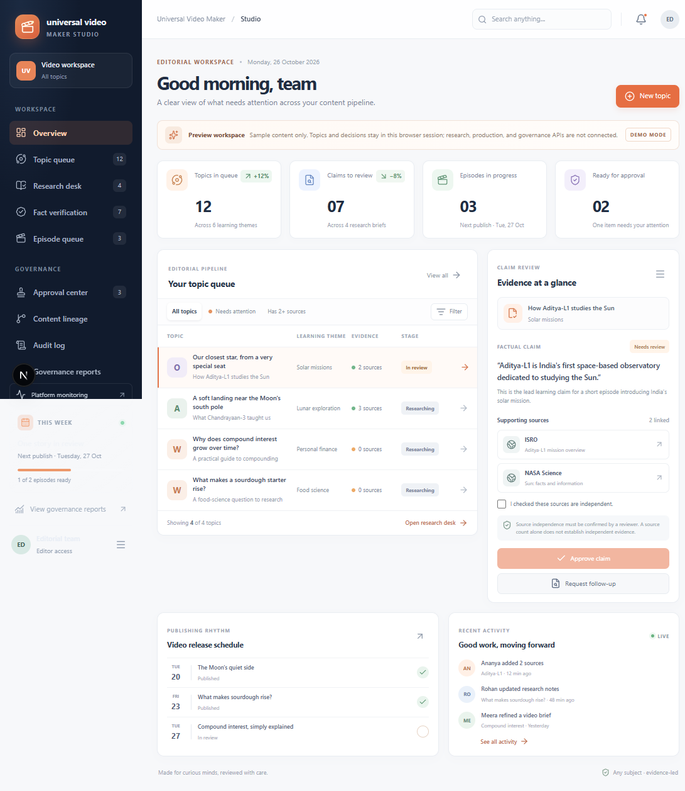

# Universal Video Maker: Production Operating Guide

This guide explains the **intended production workflow** from topic intake to
video delivery, including the human decisions, system actions, generated
records, expected files, and where each item belongs. It is written for
editors, fact reviewers, publishers, and operators.

> **Read this before using the product:** The current repository is not yet a
> production video-generation application. The authenticated topic queue can
> persist topic records, but the other web pages remain previews and do not run
> the end-to-end workflow described below. This guide documents the approved
> system design and implemented backend building blocks; it is not a claim that
> the workflow is live. Do not use preview screens to make real approvals or
> expect them to create or save a video.

## 1. What the production product is designed to do

Universal Video Maker is designed to take an editor-approved topic through a
controlled process:

1. Record a topic and its intended audience and purpose.
2. Find and preserve research source excerpts.
3. Have a qualified person review claims and evidence.
4. Draft an evidence-linked episode plan and storyboard.
5. Approve a specific storyboard revision and its estimated render spend.
6. Render the approved video package on GPU infrastructure.
7. Validate the returned media and store it durably.
8. Prepare a release package; require a publisher's explicit decision.
9. Record manually observed platform analytics.

The system is not designed to autonomously decide that factual claims are
true, approve its own work, or publish content without a person authorizing
release.

## 2. Production readiness and how to interpret this guide

There is no running production deployment documented or connected in this
repository. In particular, the browser UI currently shows illustrative sample
data, Keycloak is not connected to UI sign-in, workflow APIs are not connected
to the UI, and the custom LTX-2.5 RunPod worker is not implemented.

The labels below distinguish the planned operator experience from today's
implementation:

- **Implemented building block** — backend logic or an adapter exists, but may
  not be reachable through the UI or wired into an end-to-end workflow.
- **Planned production behavior** — the expected behavior once the remaining
  integration and deployment work is complete.
- **Not available today** — do not expect this action to work in the current
  web application.

The screenshot later in this guide is from the current preview only. It does
not show a production workflow or a real generated video.

## 3. People and responsibilities

The production design uses role-based responsibilities:

| Role | What this person is expected to do |
|---|---|
| **Editor** | Add/manage topics, review research, create episode plans and storyboards, request revisions |
| **Fact Reviewer** | Inspect source evidence, assess support and contradictions, verify or return claims for follow-up |
| **Publisher** | Review release metadata/package, authorize release, record publication details and analytics |
| **Viewer** | Read queues, episodes, schedules, reports, and permitted records |
| **Admin / Operator** | Manage users, roles, configuration, infrastructure, provider credentials, backups, and incidents |

The intended production identity provider is Keycloak. The current API verifies
a bearer token only at `/api/v1/auth/me`; UI login, internal-user mapping, and
authorization on workflow operations are not yet connected. Until those are
complete, the roles above describe the target process, not enforced access in
the web preview.

## 4. Before a production workflow can run

An operator must deploy and configure the services before users can follow the
steps below:

1. Deploy PostgreSQL and apply Alembic migrations. PostgreSQL is the planned
   authoritative store for workflow records, revisions, approvals, audit
   events, render jobs, and publication/analytics records.
2. Deploy Keycloak with a supported persistent database and HTTPS. Configure
   the realm, clients, roles, users, and mappings to internal application
   accounts.
3. Deploy the API and web app behind HTTPS; connect the UI to authenticated
   API routes.
4. Configure Tavily and Ollama if those providers are selected. Install the
   chosen Ollama chat and embedding models.
5. Provision private MinIO/S3-compatible storage, create the bucket, and set
   retention, backup, encryption, and least-privilege policies.
6. Implement and deploy the custom RunPod Serverless/ComfyUI worker for the
   selected LTX-2.5 workflow. Provide an approved model cache and storage
   access to the worker. Ensure it can upload video outputs to the private
   object store over HTTPS.
7. Configure `ffprobe` on the media-inspection host and implement the
   orchestration, output transfer, assembly, and user-facing delivery flow.
8. Test backups/restores, role enforcement, audit logging, spend caps,
   provider failure handling, and a complete render using non-production
   content before onboarding real users.

See [Configuration and Deployment Setup](./configuration-setup.md) for the
specific credentials and environment settings. The current `startup.ps1`
script is a development launcher and must not be used as a production service
manager.

## 5. End-to-end production workflow

### Stage 1 — Create a topic

**What the user does (planned):**

1. Sign in with their organization account.
2. Choose **New topic**.
3. Enter a topic in ordinary language, such as “How do solar panels work?”
4. Supply the audience, learning objective, language, intended formats, and
   any editorial constraints when those fields are available.
5. Save the topic to the queue.

**What the system is intended to do:**

- Validate and normalize the topic.
- Store it in PostgreSQL with its status, owner, and creation/audit metadata.
- Keep it in a proposed or research-needed state until an editor moves it
  forward.

**Current status:** The preview's **New topic** form accepts a topic and
optional category but stores it only in browser memory. The topic disappears
after a refresh or closing the tab. Topic Discovery backend code exists for
typed candidates from injected catalogs; the page does not call it, and no
catalog/scheduled discovery workflow is configured.

### Stage 2 — Gather research and source records

**What the user/workflow is intended to do:**

1. Start research for the selected topic.
2. The research workflow searches configured sources (Tavily is the current
   search adapter) and gathers result metadata and short excerpts.
3. An extraction model (Ollama is the current local model adapter) may turn
   those excerpts into candidate factual claims and open questions.
4. Inspect each source, its publisher, canonical URL, retrieval date, excerpt,
   and stored content hash.

**What the backend building blocks do:**

- The Tavily adapter searches and can persist short search-result excerpts as
  local content-hashed snapshots. It does **not** fetch or archive full web
  pages.
- `ResearchService` can create numbered research revisions from caller-
  supplied source snapshots, findings, and candidate claims.
- New factual claims begin **unverified**. Model output is a research aid, not
  an approved fact.

**Current status:** Provider and research modules exist, but search-to-research
workflow orchestration is not exposed in the API or connected to the UI.
Source snapshots are not generated by adding a topic in the preview.

### Stage 3 — Review and verify factual claims

**What a Fact Reviewer is expected to do:**

1. Open a claim and read its supporting, contradicting, and contextual
   evidence.
2. Follow the original source references and assess whether the source
   supports the exact claim in context.
3. Consider whether apparently different sources share a publisher, hostname,
   or source lineage; copies of one report do not automatically count as
   independent confirmation.
4. Choose a decision: verify, reject, or request follow-up, and record a
   rationale. Leave ambiguous or contradictory claims unresolved.

**What the backend building block enforces:**

- The Fact Check service records a permission-checked human decision and audit
  event.
- A verified decision requires at least two independent supporting groups and
  no conflicting evidence.
- Rejection requires contradicting evidence. Ambiguous cases should remain in
  follow-up.
- These checks assist editorial review; they do not prove truth or replace
  qualified judgment.

**Current status:** Fact Check logic exists, but there is no connected review
API or authenticated review UI. The preview's **Approve claim** button only
changes temporary local display state; it does not verify or persist a claim.

### Stage 4 — Draft and review an episode plan

**What the editor is expected to do:**

1. Start an episode plan from a topic with reviewed, verified evidence.
2. Review the learning objectives, story arc, timing, narration, and citations.
3. Request changes if the plan overstates evidence or has weak explanations.
4. Save an acceptable plan as a draft revision.

**What the planner is designed to validate:**

- A three-minute episode timeline totaling exactly **180 seconds**.
- Learning objectives and a staged story arc.
- Exactly **three Shorts concepts**, each **30–60 seconds**.
- Citations and verbatim quotes for factual narration; cited evidence must
  remain currently verified and unchanged.
- Plans remain drafts and require editorial review; model-generated text does
  not grant approval.

The Ollama plan generator can draft an in-memory outline from verified
retrievals, but it does not itself persist or approve the plan. Citation and
quote checks are not a guarantee of semantic entailment; a human still checks
that the cited source really supports the wording.

**Current status:** Planner services exist, but plan generation and review are
not available through the web UI or a workflow API.

### Stage 5 — Create and approve a storyboard

**What the editor is expected to do:**

1. Create a storyboard revision from the latest accepted episode-plan draft.
2. For each beat, check the visual description, camera direction, visual
   prompt, and required assets.
3. Confirm that timings, narration, titles, and citations match the plan.
4. Submit a specific storyboard revision for approval.

**What the storyboard service is designed to do:**

- Initially create exactly one scene per plan beat.
- Inherit the beat timing, narration, and citations rather than silently
  inventing new factual narration.
- Recheck that cited claims remain verified and unchanged.
- Record the revision and audit event.

An approval must refer to the exact storyboard revision. If that revision
changes, it needs a new review and approval.

**Current status:** Storyboard persistence logic exists, but it stores visual
directions and asset requirements only. It does not generate media and has no
connected UI/API.

### Stage 6 — Approve the render and its spend

**What an authorized editor/publisher is expected to do:**

1. Inspect the storyboard revision that will be rendered.
2. Review the estimated cost and the per-job/monthly spend policy.
3. Approve that exact revision and cost before any billable GPU job starts.

**What the RunPod adapter currently implements:**

- It targets a configured RunPod Serverless endpoint.
- It requires approval for the exact storyboard revision and enforces
  configured per-attempt/monthly budget checks in the service.
- It sends a render-job UUID to support worker-side request deduplication.
- It records remote job status/runtime/cost and supports status checks,
  cancellation, and bounded manual retry after terminal failure.
- The caller must commit the queued render-job record before making the
  external, potentially billable dispatch.

These application checks do not by themselves guarantee a provider-side hard
spending cap. Configure independent provider billing alerts/limits and test
the actual cost accounting before paid use.

**Current status:** The adapter is implemented and mocked in tests, but no
production endpoint or worker is deployed, the UI cannot submit jobs, and
automatic polling/scheduling and output transfer are not complete.

### Stage 7 — Render and assemble media

**Intended production behavior:**

1. The workflow sends the approved job to an isolated RunPod GPU worker.
2. The selected path is LTX-2.5 through ComfyUI, subject to model access and
   license terms.
3. The worker renders the scenes, uploads outputs to private object storage,
   and returns job status plus a checksummed output manifest.
4. The control plane collects outputs and assembles final formats using a
   media pipeline (FFmpeg is the planned primary assembly engine).
5. Failures are surfaced to an operator; eligible failures may be retried
   within policy. A worker must deduplicate repeated submissions of the same
   render-job UUID.

The intended output bundle for a completed render is:

- **1 main episode:** 16:9, three minutes.
- **3 Shorts:** 9:16, each 30–60 seconds.
- **4 WebVTT caption files.**
- **1 readable thumbnail.**

**Current status:** LTX-2.5/ComfyUI worker, scene generation, multi-scene
assembly, RunPod-to-MinIO transfer, captions, thumbnail generation, automatic
monitoring, and a user-facing render action are not implemented end to end.
The RunPod adapter alone does not produce a video.

### Stage 8 — Validate outputs and find the files

**What the system is designed to validate before marking assets complete:**

- Actual media content checksum and metadata, not just a filename or a worker
  success response.
- Expected aspect ratio/dimensions, duration, audio presence/levels, frame
  rate/encoding, subtitle timing, and readable thumbnail.
- Required artifact count and association with the approved render job and
  storyboard revision.
- Duplicate output registration.

The rendering registrar and local/MinIO `ffprobe` inspector provide backend
building blocks for checksumming and media inspection.

**Where production outputs are intended to live:**

- Binary artifacts (episode, Shorts, captions, thumbnails) should be stored
  in the configured private MinIO/S3-compatible bucket.
- The workflow database should retain metadata, checksum, artifact URI,
  render-job ID, storyboard revision, variant, and inspection outcome.
- The browser should eventually present approved output links or a download
  action, subject to access controls and retention rules.

**Current status:** MinIO upload/download and artifact inspection adapters
exist, but the bucket is provisioned separately, RunPod does not transfer
outputs to it, and there is no rendered-video library or download control in
the web app. There is currently no production output location a user can
retrieve a generated video from.

### Stage 9 — Prepare and release a publishing package

**What the Publisher is expected to do:**

1. Review the validated assets and their provenance.
2. Review/edit titles, descriptions, tags, hashtags, thumbnail choice, and
   other release metadata.
3. Approve the immutable package associated with the exact storyboard
   revision.
4. Publish through the organization's chosen platform workflow once that
   platform integration and authorization are available.
5. Record the external platform ID, public HTTPS URL, and publication
   timestamp.

**What the publishing backend currently supports:**

- Create a package from a completed render's metadata and validated asset
  manifest.
- Fingerprint the package and require explicit Publisher approval before its
  status may be recorded as published.
- Require an external ID, public URL, and timezone-aware publication
  timestamp when recording publication.

**Current status:** This is manual record-keeping logic, not a YouTube or
other platform API integration. The app does not upload or post videos, and
the web UI does not expose package review/publishing.

### Stage 10 — Record performance analytics

**Intended operator action:** At the chosen reporting intervals, an authorized
Publisher enters cumulative platform counters and the capture time/source.

**What the analytics service currently supports:**

- Store time-stamped cumulative snapshots.
- Reject duplicate timestamps and counters that decrease unexpectedly.
- Summarize measured click-through rate, average view duration, engagement,
  cost, validation ratio, and citation coverage when the required records are
  present.

**Current status:** The service does not fetch data from YouTube or other
platform APIs. There is no connected analytics UI; the monitoring dashboard
shows only workflow and render records stored in PostgreSQL and is not a full
system health check.

## 6. What happens when a step fails?

The production workflow is designed to stop safely rather than silently
pretend it succeeded:

- **No evidence or conflicting evidence:** leave the claim unverified and
  request more research or reviewer attention.
- **Plan cites stale/unverified material:** do not persist it as an acceptable
  evidence-linked draft; correct the citations or revisit fact review.
- **Storyboard changes after approval:** request approval for the new revision.
- **Cost exceeds configured policy:** do not dispatch the render without the
  required approval/budget change.
- **Render provider failure:** record the failure; allow only policy-bounded
  retry after a terminal failure.
- **Missing or invalid output:** do not register it as a completed asset;
  surface the validation failure for operator/editor follow-up.
- **Package or publication details are incomplete:** do not mark the package
  published.

The full workflow engine, automatic recovery, notifications, and all error
paths are not yet integrated. Operators must not assume these protections
exist just because individual backend modules contain related checks.

## 7. Screenshot: current preview, not the production product

This screenshot shows the current local governance preview. The displayed
topics, people, claims, numbers, activity, review buttons, and dates are
illustrative. It is **not** a production interface walkthrough: selecting
**New topic** or a review decision changes only temporary browser state and
does not call the backend.

## 8. What the user can actually do today

To inspect the preview on a Windows development machine:

1. Install Python 3.11 or newer and Node.js/npm compatible with the project.
2. Open PowerShell in the repository folder.
3. Run `.\startup.ps1`.
4. Open `http://127.0.0.1:3000`.
5. Navigate the sample sections or try **New topic** to see the preview
   interaction.

The startup helper runs the API and web application in development mode and
writes logs under `logs\startup`. It does not start PostgreSQL, Keycloak,
MinIO, Ollama, or RunPod. Adding topics and review decisions remain only in
browser memory and disappear after reload/closing the tab. No video is
rendered or saved. The API health endpoint only indicates that the API process
responds; it does not mean the production dependencies or workflow are live.

## 9. Data and retention summary

| Data | Intended production location | Current behavior |
|---|---|---|
| Users, topics, revisions, claims, approvals, jobs, audit events | PostgreSQL | Browser preview does not persist these actions |
| Vector embeddings/index | ChromaDB derived index, rebuildable from source records | Adapter exists; not a complete production indexing workflow |
| Tavily excerpt snapshots | Configured snapshot storage and/or durable object storage | Adapter can write local content-hashed excerpts when called; no UI invocation |
| Rendered video, Shorts, captions, thumbnail | Private MinIO/S3-compatible bucket | Adapter exists; worker transfer and user access are not connected |
| Model weights/cache | Protected worker cache/volume under accepted model terms | No worker/cache is supplied by the current project |
| Runtime logs/metrics | Production observability platform | Startup logs are local files; monitoring screen shows DB-recorded workflow/render data only |

The production owner must set retention, privacy, access, deletion, and backup
policies before processing real content.

## 10. Related documentation

- [Configuration and Deployment Setup](./configuration-setup.md) — API keys,
  dependencies, environment settings, and production launch blockers.
- [Architecture](./architecture.md) — components, data flow, governance,
  security, and intended system boundaries.
- [README](../README.md) — current repository features and implementation
  limitations.

Never put credentials in this guide, screenshots, source control, or browser
code. Use a production secret manager and least-privilege credentials.
